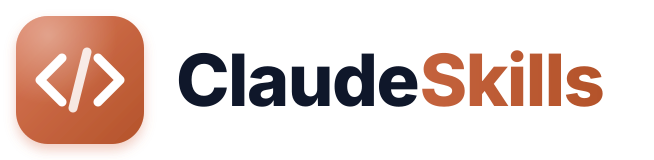

<div align="center">

<a href="#readme">
  <picture>
    <source media="(prefers-color-scheme: dark)" srcset=".github/assets/logo-dark.svg">
    
  </picture>
</a>

<h3>Skills para o Claude Code que funcionam em qualquer projeto</h3>

<p>Cada skill mora na sua pasta, sem nada amarrado a uma empresa, máquina ou repositório.</p>


<p>
  <a href="#skills"><b>Skills</b></a> ·
  <a href="#instalação"><b>Instalação</b></a> ·
  <a href="#estrutura-de-pastas"><b>Estrutura</b></a> ·
  <a href="#contribuindo"><b>Contribuindo</b></a>
</p>

</div>

<br>

<details>
<summary><b>Índice</b></summary>

- [Sobre o projeto](#sobre-o-projeto)
- [Skills](#skills)
- [Instalação](#instalação)
- [Estrutura de pastas](#estrutura-de-pastas)
- [Contribuindo](#contribuindo)
- [Licença](#licença)

</details>

## Sobre o projeto

[Skills](https://code.claude.com/docs/en/skills) são pacotes de instruções que o
Claude Code carrega quando a tarefa pede, ou quando você chama pelo nome (`/nome-da-skill`).
Este repositório reúne skills escritas para servir em qualquer projeto: nenhuma depende de um
domínio, de um caminho de máquina ou de uma ferramenta interna.

As skills estão escritas em português.

> [!NOTE]
> Projeto da comunidade, não oficial. Não tem ligação com a Anthropic.

## Skills

| Skill | O que faz | Como chamar |
|---|---|---|
| [prompt-logan](skills/prompt-logan/) | Transforma um pedido solto num prompt fechado para um agente de código, com critérios de aceite numerados. Antes, olha a aplicação aberta no navegador e, se o pedido mexe em tela, monta uma maquete para você aprovar. | `/prompt-logan <pedido>` |

## Instalação

### Jeito mais fácil: peça ao Claude

Abra o Claude Code, cole o texto abaixo e envie. Ele baixa e instala sozinho.

```text
Instale a skill "prompt-logan" do repositório https://github.com/escolaparaprogramadores/claude-skills para todos os meus projetos: copie a pasta skills/prompt-logan (com os arquivos de dentro) para a pasta de skills do meu usuário (~/.claude/skills/prompt-logan). Se ela já existir, me pergunte antes de substituir. No fim, me mostre os arquivos instalados.
```

Depois abra uma sessão nova e chame `/prompt-logan <seu pedido>`.

Quer a skill só em um projeto? Abra o Claude Code na pasta do projeto e cole este:

```text
Instale a skill "prompt-logan" do repositório https://github.com/escolaparaprogramadores/claude-skills só neste projeto: copie a pasta skills/prompt-logan (com os arquivos de dentro) para a pasta de skills deste projeto (.claude/skills/prompt-logan). Se ela já existir, me pergunte antes de substituir. No fim, me mostre os arquivos instalados.
```

### Jeito manual

Copie a pasta da skill para uma destas pastas:

| Pasta | Vale para |
|---|---|
| `~/.claude/skills/` | todos os seus projetos |
| `<seu-projeto>/.claude/skills/` | só aquele projeto (e quem clonar o projeto) |

macOS / Linux:

```bash
git clone https://github.com/escolaparaprogramadores/claude-skills.git
mkdir -p ~/.claude/skills && cp -r claude-skills/skills/prompt-logan ~/.claude/skills/
```

Windows (PowerShell):

```powershell
git clone https://github.com/escolaparaprogramadores/claude-skills.git
New-Item -ItemType Directory -Force "$HOME\.claude\skills" | Out-Null; Copy-Item -Recurse claude-skills\skills\prompt-logan "$HOME\.claude\skills\"
```

> [!TIP]
> Abra uma sessão nova do Claude Code depois de copiar. Cada skill tem um `README.md` com os
> requisitos dela.

## Estrutura de pastas

```text
skills/
└── <nome-da-skill>/
    ├── SKILL.md      instruções que o Claude segue (com o cabeçalho name/description)
    ├── README.md     para humanos: o que faz, como usar, requisitos
    └── scripts/      apoio opcional que a skill executa
```

## Contribuindo

Skill nova entra em `skills/<nome-da-skill>/`, no formato acima, e ganha uma linha na tabela
[Skills](#skills). Antes de abrir o PR, confira que ela não traz caminho de máquina, domínio,
nome de empresa, credencial ou dado pessoal.

## Licença

Distribuído sob a licença MIT. Veja [LICENSE](LICENSE).

<p align="right">(<a href="#readme">voltar ao topo</a>)</p>
